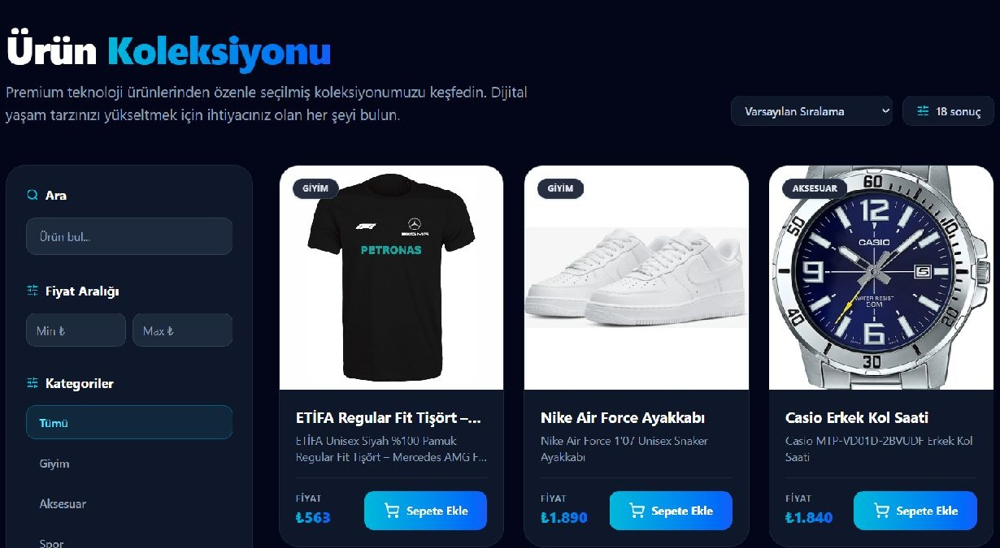
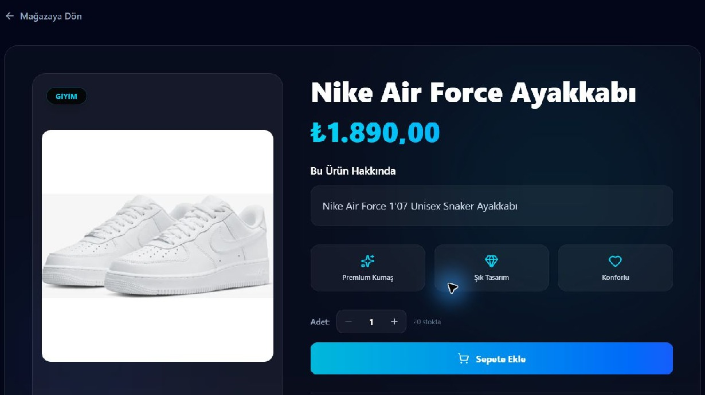

# Snapbuy

A full-stack e-commerce demo built with **Next.js, TypeScript, Prisma and PostgreSQL**, with a Turkish storefront, an admin panel and optional image-based product search.

This edition runs with a database on your own computer. Checkout creates demo orders without collecting card details or processing payments.

## Screenshots

### Storefront


### Product catalogue



### Product details



## Features

- Product browsing, text search, category and price filters, sorting and pagination.
- Product details, customer reviews and a shopping cart with quantity controls.
- Account registration, login, profile settings and customer order history.
- Demo checkout with server-side price and stock validation.
- Admin pages for products, orders and users, protected by server-side role checks.
- Light and dark themes.
- Optional visual search using a Python FastAPI service and OpenCLIP image embeddings.

## Tech stack

| Area | Technology |
| --- | --- |
| Web application | Next.js App Router, React, TypeScript |
| Styling | Tailwind CSS, next-themes, Lucide icons |
| Data | PostgreSQL, Prisma, pg |
| Authentication | bcrypt password hashes, signed JWTs in HttpOnly cookies |
| Optional visual search | Python, FastAPI, PyTorch, OpenCLIP, NumPy |
| Checks | Node.js tests, ESLint, GitHub Actions, database integration checks |

## Run locally on Windows

Install **Node.js 24** and **PostgreSQL 18 with pgvector**. Clone the repository, open its folder, then run:

```powershell
npm ci
npm run dev
```

Open [http://127.0.0.1:3000](http://127.0.0.1:3000). Startup prepares the local database on `127.0.0.1:55432`, applies migrations and generates the Prisma client. `Start-Snapbuy.cmd` is an alternative launcher.

A fresh clone starts with an empty catalogue. Product image files alone do not create database records. Use the admin product pages to add products. Initial login instructions are generated in `.local/LOGIN.txt`.

Database files, private settings, passwords and logs stay in the ignored `.local/` directory and `.env`. Preserve them when moving an existing installation. Stop the website and use `Stop-Database.cmd` before moving the project.

For detailed setup, see [OFFLINE-SETUP.md](OFFLINE-SETUP.md).

## Optional visual search and offline use

The image-search feature runs in a separate **Python FastAPI server** using **OpenCLIP**. It converts product images and an uploaded query image into embeddings, then returns the closest matching products.

Keep the website running in one terminal. Open a second terminal in the project folder:

```powershell
cd visual-search-server
python -m pip install -r requirements.txt
python generate_embeddings.py
python main.py
```

Install dependencies once. Rebuild the index on first setup or when replacing an old index. For later sessions, start the service with `python main.py`. Python dependencies and the CLIP model weights need internet for their initial download; cache them before offline use.

- [Health check](http://127.0.0.1:8000/health): check that `products_indexed` is greater than zero.
- [Interactive API documentation](http://127.0.0.1:8000/docs): inspect the service endpoints.
- On the storefront, select the image-search icon beside the search field, upload a product photo and view the matches. This results view is useful for a README screenshot.

The service uses the local database configuration, binds to loopback and requires a generated token for reindexing. Its index is saved privately as `visual-search-server/embeddings/products.json`; legacy pickle indexes are never loaded. Existing local fonts and product images work offline; remote image URLs still require internet access and an approved `ALLOWED_IMAGE_HOSTS` setting.

## Project files

| File or folder | Purpose |
| --- | --- |
| `app/`, `components/`, `lib/` | Storefront, admin pages, API routes and shared application code |
| `prisma/`, `prisma.config.ts` | Database schema, migrations and Prisma configuration |
| `public/`, `docs/screenshots/` | Product images and README screenshots |
| `visual-search-server/` | Optional Python image-search service |
| `scripts/` | Local database setup, diagnostics and checks |
| `Start-Snapbuy.ps1` | Prepares PostgreSQL before `npm run dev` |
| `Start-Snapbuy.cmd`, `Stop-Database.cmd`, `Test-Snapbuy.cmd` | Windows shortcuts to start, stop and verify the application |
| `package.json`, `package-lock.json` | Commands and reproducible dependency versions |
| `next.config.ts`, `tsconfig.json`, `eslint.config.mjs`, `postcss.config.mjs` | Framework, TypeScript, lint and styling configuration |
| `proxy.ts` | Admin-page access checks |
| `README.md`, `OFFLINE-SETUP.md`, `SECURITY.md` | Project overview, setup instructions and security scope |

The completed Supabase migration tooling has been removed from the current version. Earlier migration tools remain available in Git history. Existing local databases and private records are separate from the repository.

## Validation

```powershell
npm test
npm run lint
```

With the website running, use a second terminal for:

```powershell
npm run db:test
```

The integration checks exercise temporary accounts, privacy, authorization and checkout, then clean up their fixtures. GitHub Actions builds and tests against a separate disposable PostgreSQL database.

For a production build on this computer:

```powershell
npm run db:setup
npm run build
npm start
```

## Security and project scope

This is a local e-commerce demonstration. It is not a production payment service. Authentication uses application accounts rather than Supabase Auth. Read [SECURITY.md](SECURITY.md) for the security controls, known limitations and requirements before internet hosting.
